# TerraScope

TerraScope is a natural-disaster monitoring and incident-response platform. It pulls live earthquake, volcano, wildfire and severe-storm data, checks it against alert rules, and gives response teams a Situation Room to run an incident from the first alert to the after-action review.

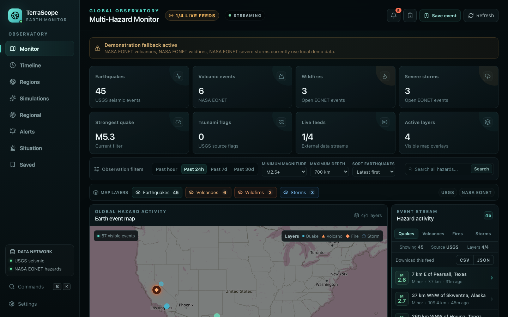

- **Monitor.** Earthquakes from USGS, and volcanoes, wildfires and severe storms from NASA EONET, on a map and a timeline.
- **Alert.** Rules by hazard, location, radius and intensity, evaluated every two minutes and on demand.
- **Respond.** Incidents with actions, resource requests, evacuation zones and shelters, lifeline outages and damage assessments.
- **Review.** Situation reports, closure review, improvement actions, preparedness exercises and an audit ledger.
- **Operate.** Optional sign-in with three roles, an activity log of who changed what, and CSV or JSON export.

The backend is Spring Boot 4 on Java 21 with PostgreSQL. The web app is Next.js 16 with React 19. Everything runs with one command.

## Try it

You only need Docker Desktop (or Docker Engine with the Compose plugin).

```
bash scripts/start.sh --demo
```

Open http://localhost:3000 when it finishes. The first run builds both apps and takes a few minutes. Later runs reuse the build and start in seconds.

`--demo` fills the app with a small demo dataset once it is running, so every screen has something to show. It needs Node.js 18 or newer on your computer, and you can leave the flag off for an empty installation. See [Demo data](#demo-data).

To turn on sign-in as well:

```
bash scripts/start.sh --sign-in --demo
```

That generates a signing secret and a first administrator password, saves them in `.env` and prints them once. See [Sign-in and roles](docs/sign-in-and-roles.md).

| Service  | What it is                | Address                              |
| -------- | ------------------------- | ------------------------------------ |
| web      | The TerraScope interface  | http://localhost:3000                |
| backend  | The API                   | http://localhost:8087/api/v1/status  |
| postgres | The database              | localhost:55433                      |

Stop everything and keep the data with `docker compose down`. Add `-v` to delete the database too.

## Feature tour

### Live hazard map and feeds

The dashboard shows four hazard feeds on one map and in an event stream: earthquakes (USGS), and volcanoes, wildfires and severe storms (NASA EONET). Filter by period, magnitude or search text, select an event to see its details, and save it for later. New data arrives in the background and a toast tells you when it does.

When a source can't be reached, the backend serves a small built-in sample feed and marks it as not live, so the app stays usable offline.

### Alerts that open incidents

Alert rules match a hazard type (or all of them) inside a radius around a point, with an optional minimum intensity. The backend evaluates them after every feed fetch and from the **Evaluate** button. A matching event raises one alert per rule, never a duplicate, and the browser is told over a live stream. From the alert center you can acknowledge or dismiss an alert, or open an incident from it.

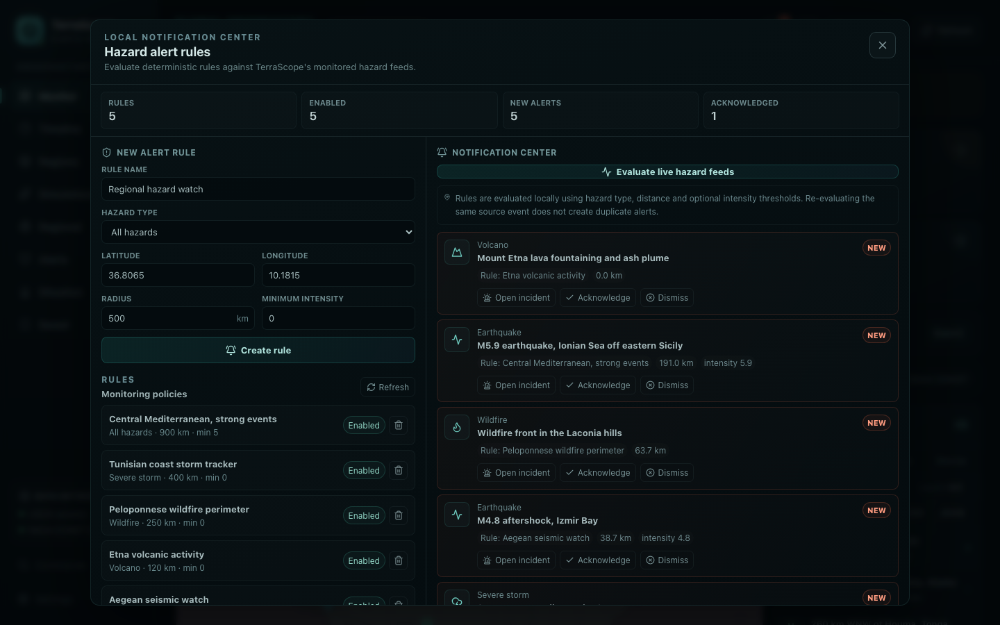

### Situation Room

Each incident has an owner, a severity, a status and a full timeline of everything that happened to it. The workspace is split into tabs:

- **Overview.** A command pulse with operational pressure, blockers and snapshots over time, plus notes and the response timeline.
- **Operations.** Response actions, resource requests and allocation, evacuation zones and shelters, and critical lifelines.
- **Recovery and reporting.** Damage assessments with verification and repair progress, and situation reports you can print.
- **After-action.** Closure readiness, after-action reviews, improvement actions and preparedness exercises.
- **Resilience assurance.** Validation, certification, evidence packages and the audit ledger.

A separate **Portfolio governance** view rolls incidents up into a scorecard, strategic objectives and outcomes, and covers closure certificates with Ed25519 signatures, trust anchors, ledgers and offline verification.

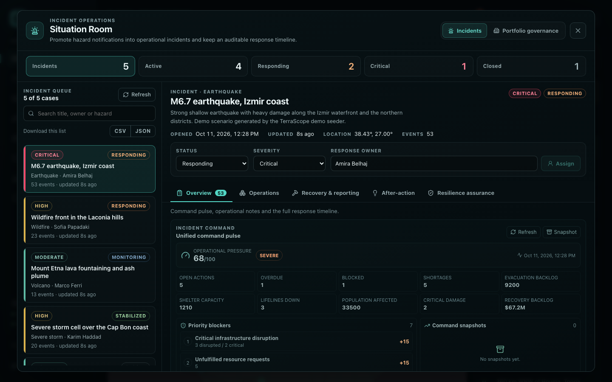

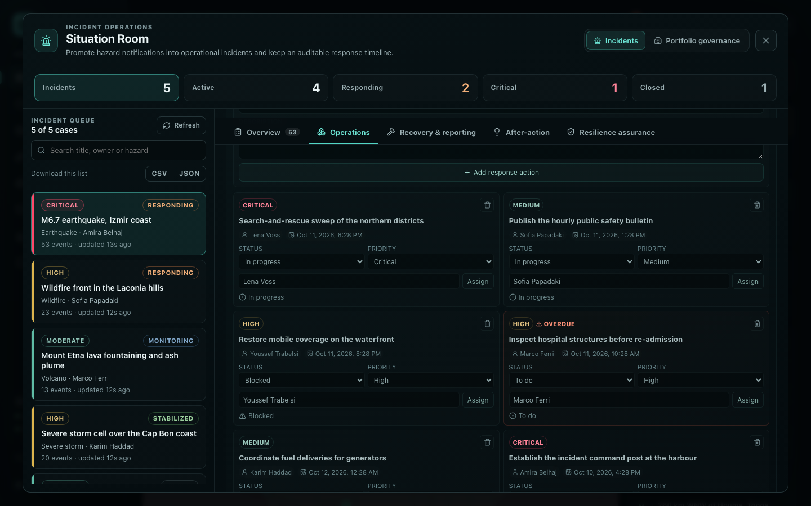

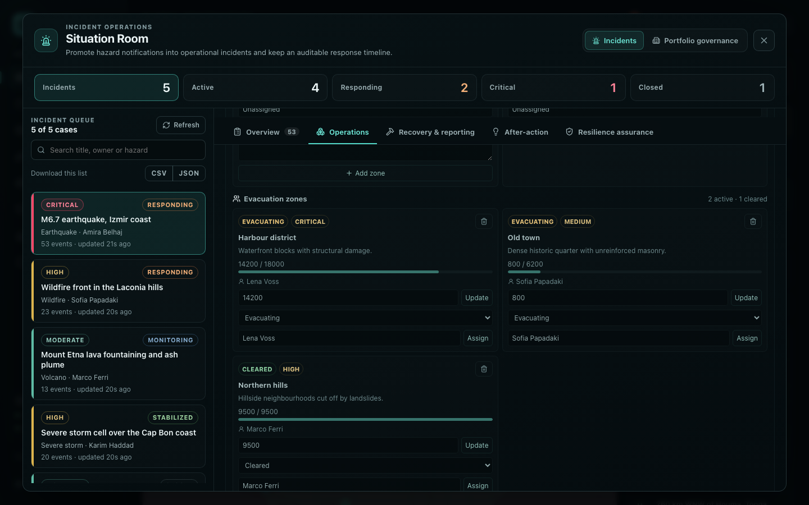

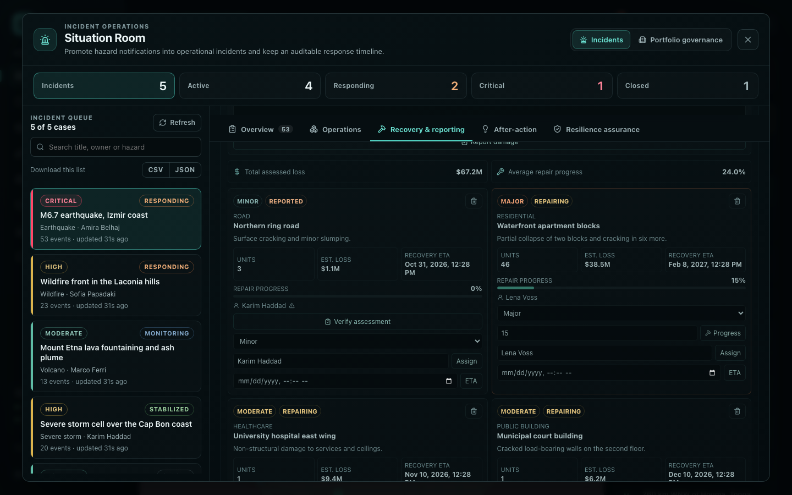

### Impact simulations and regional analysis

An impact simulation takes a hazard, a location, a radius, an intensity, the exposed population, and how resilient the infrastructure and how ready the responders are. It returns the affected and displaced population, an estimated economic loss, a composite risk score and a band from Low to Extreme, and every run is kept in a history. Regional analysis looks at one area, counts the hazards inside it, finds the nearest event and gives an activity index from Quiet to Critical.

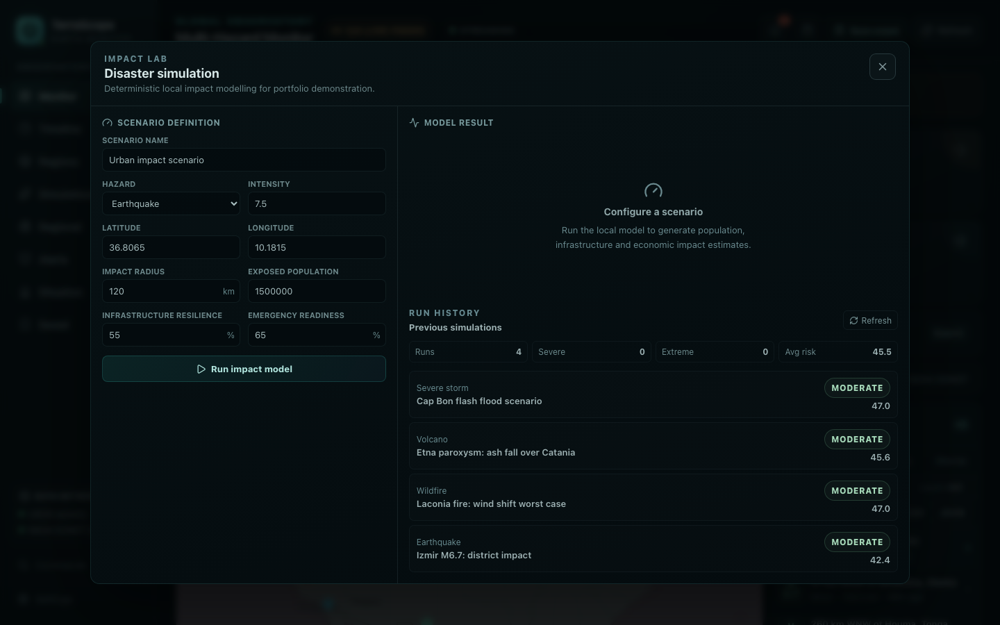

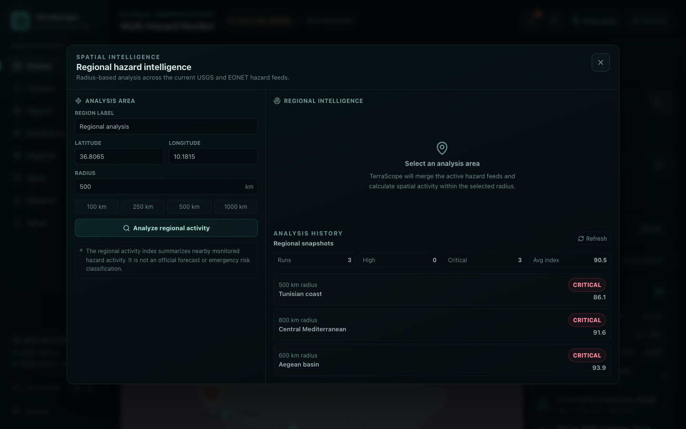

### Saved events

Any event can be saved with a priority from Low to Critical, so the ones you care about stay in one list.

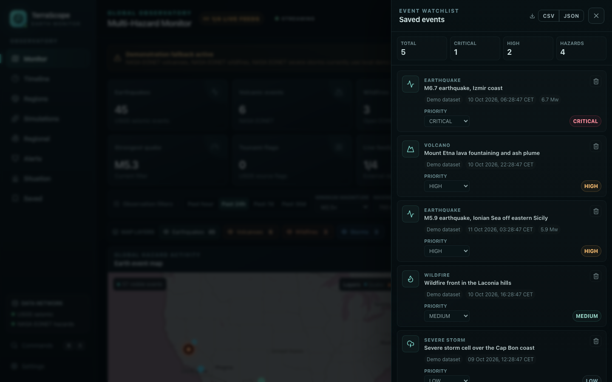

### Who did what

Sign-in is optional. When it is on there are three roles, Viewer, Operator and Administrator, and the activity log records every change made by an Operator or Administrator, filterable by person.

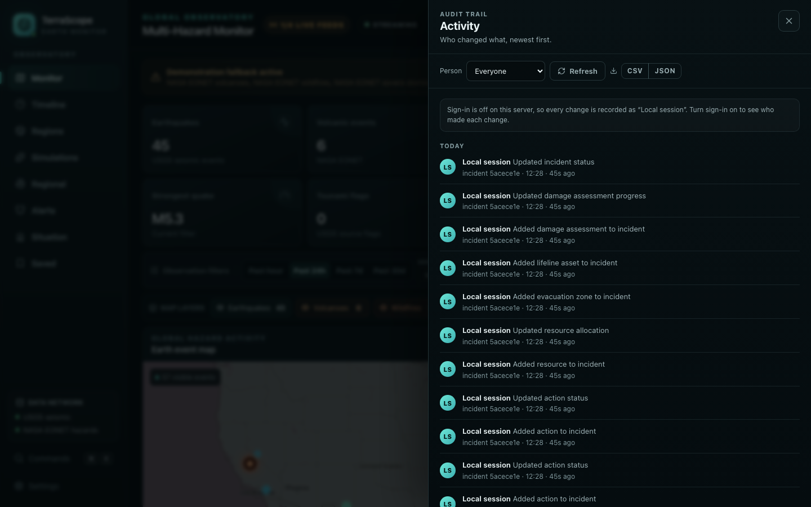

### Built to be used every day

- **Command palette.** Press Ctrl+K (⌘K on a Mac) to jump anywhere or run a command, and use `G` then a letter to open panels from the keyboard.
- **Export.** CSV and JSON buttons on the event stream, incident queue, incident timeline, saved events and activity log.
- **Light and dark themes.** Dark by default, with Light and System in Settings. Printing always uses the light theme.
- **Phone friendly.** The layout adapts down to a phone screen.

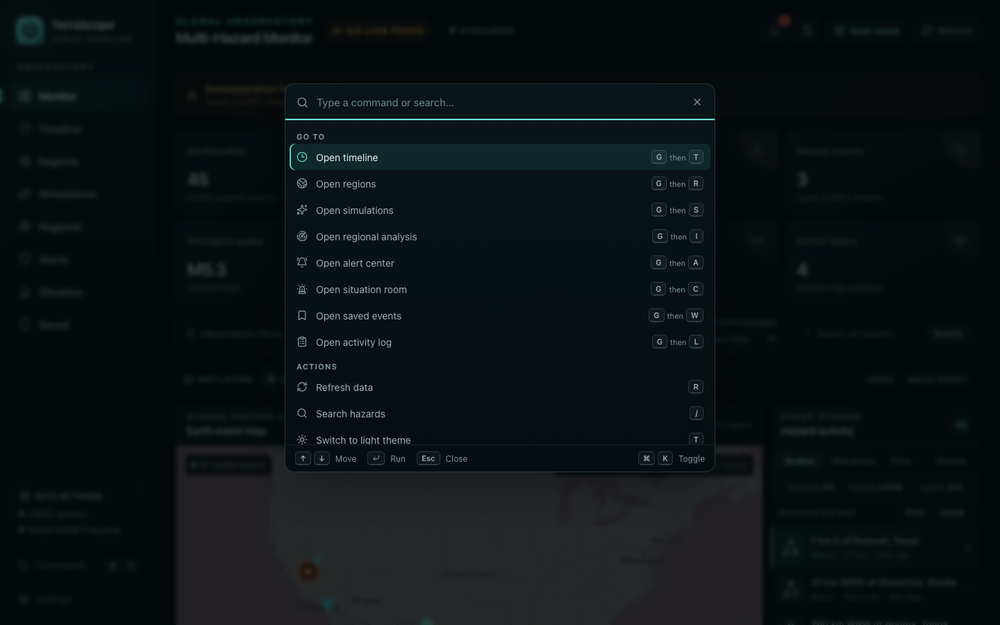

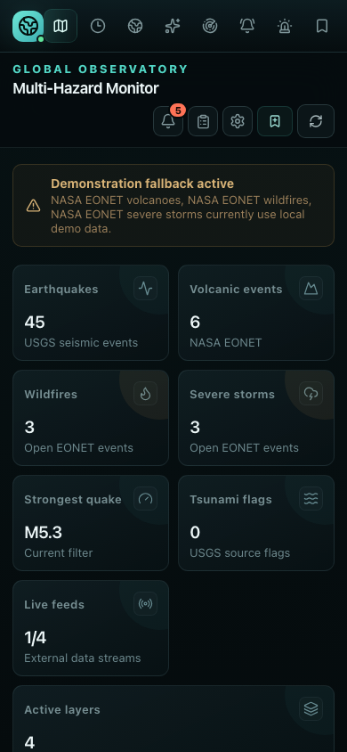

More detail: [Appearance and keyboard](docs/appearance-and-keyboard.md), [Exporting data](docs/exporting-data.md), [Activity log](docs/activity-log.md).

## Architecture

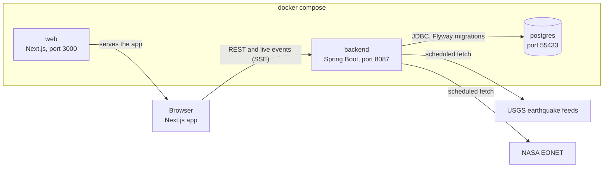

The browser loads the app from the `web` container and then talks to the API directly. The API address is built into the web app, which is why `PUBLIC_API_URL` and `CORS_ALLOWED_ORIGIN` exist in [Configuration](docs/configuration.md).

### Backend

A layered Spring Boot application under `apps/backend`:

| Layer            | Role                                                                                                           |
| ---------------- | -------------------------------------------------------------------------------------------------------------- |
| `api`            | 46 REST controllers and the request and response records. Bean Validation checks input, and errors come back as `{ code, message, timestamp }`. |
| `service`        | Business rules and transactions: alert evaluation, incident workflows, the impact and regional models, the governance and assurance services. |
| `repository`     | Plain SQL through Spring's `JdbcClient`. There is no ORM.                                                      |
| `domain`         | Enums and value records shared by the layers.                                                                  |
| `infrastructure` | Clients for the USGS and NASA EONET feeds, with a short in-memory cache.                                       |
| `security`       | Opt-in token sign-in: HMAC-SHA256 tokens, PBKDF2 password hashing, login throttling and a role policy per route and method. |
| `activity`       | An interceptor that writes the activity log, and a nightly retention job.                                      |

The schema is owned by 45 Flyway migrations in `src/main/resources/db/migration`, and the backend ships with a test suite (`mvn test`).

### From feed to alert to screen

1. `FeedIngestionScheduler` runs every two minutes (after a 20 second start-up delay) and fetches the four feeds.
2. `HazardPointCollector` turns the events into points, and `HazardAlertEngine` checks each point against every enabled rule: hazard type, great-circle distance inside the radius, and minimum intensity.
3. New alerts are stored once per rule and source event.
4. `LiveEventBroadcaster` pushes `alerts` and `feeds` events over Server-Sent Events at `/api/v1/stream`, with a keep-alive every 20 seconds.
5. The web app listens to that stream, shows a toast, updates the notification bell and refreshes what you are looking at.

### Web app

A single-route Next.js app under `apps/web`, written in strict TypeScript. `src/components` holds the dashboard, the panels and the incident boards, `src/lib` holds the API client, the live-stream hook, the session, preferences, the command registry and the export code, and `src/types` mirrors the API records. The map is Leaflet on OpenStreetMap tiles. Styling is plain CSS, and the light theme is generated from the dark one by `npm run theme`, so there is one stylesheet to maintain.

### Verifiable governance

Governance records can be exported and checked offline. Receipt ledgers carry the hash of the previous receipt, closure certificates are signed with Ed25519, and the `tools` folder has three standalone Java tools: a trust verifier, a checkpoint bundle verifier and a release integrity checker for the verifiers themselves. `scripts/verify.sh` runs the long end-to-end check: backend tests, the build, the schema and those tools.

## Tech stack

| Area      | What is used                                                                       |
| --------- | ---------------------------------------------------------------------------------- |
| Backend   | Java 21, Spring Boot 4.1, Spring MVC, Spring JDBC, Bean Validation, Actuator       |
| Database  | PostgreSQL 17, Flyway                                                              |
| Web       | Next.js 16, React 19, TypeScript, Leaflet, lucide icons                            |
| Packaging | Docker Compose, multi-stage images that run as a non-root user                     |
| Data      | USGS Earthquake Hazards Program, NASA EONET, OpenStreetMap map tiles               |

## Demo data

`bash scripts/start.sh --demo` runs `scripts/seed-demo.mjs` for you. You can also run it against an app that is already up:

```
node scripts/seed-demo.mjs
```

It creates five alert rules and the alerts they trigger, five saved events, four impact simulations, three regional analyses and five incidents. The largest incident has a full set of actions, resource requests, evacuation zones, shelters, lifelines, damage assessments and a situation report. One incident is closed, and the others sit at different stages, so the dashboards show a realistic mix.

- Running it again is safe. Anything that already exists is left alone, and it fills in whatever a failed run missed.
- It signs in with the administrator account from `.env` when sign-in is on. Use `--username` and `--password`, or `TERRASCOPE_USERNAME` and `TERRASCOPE_PASSWORD`, to use another account.
- Everything is fictional and marked as demo data: incident source ids start with `demo-` and saved events name "Demo dataset" as their provider.
- Alert rules also run against the live feeds, so real alerts can appear next to the demo ones.
- `node scripts/seed-demo.mjs --dry-run` lists what it would create, and `--help` shows every option.

To start over, run `docker compose down -v` and start again.

## Screenshots

The images in this README are real screenshots taken from a running app with the demo data loaded. To retake them:

```
bash scripts/start.sh --demo
bash scripts/screenshots.sh
```

The first run installs Playwright and a Chromium browser into `tools/screenshots`. The images land in `docs/screenshots`. The map needs internet access for its OpenStreetMap tiles, and the script skips the map screens instead of saving an empty map if the tiles don't load. Useful options:

| Option                 | What it does                                                |
| ---------------------- | ----------------------------------------------------------- |
| `--theme light`        | Take light theme images, named `<screen>-light.png`.        |
| `--only dashboard,alerts` | Retake just those screens. `--list` shows all the names. |
| `--scale 2`            | Sharper images at twice the pixel density.                  |
| `--channel chrome`     | Use your installed Chrome and skip the Chromium download.   |
| `--url <address>`      | Photograph an app running somewhere other than port 3000.   |

## Documentation

| Page                                                       | What is in it                                              |
| ---------------------------------------------------------- | ---------------------------------------------------------- |
| [Configuration](docs/configuration.md)                     | Every setting for Docker, the backend and the web app.     |
| [Sign-in and roles](docs/sign-in-and-roles.md)             | Turning sign-in on, the three roles, user management, API sign-in. |
| [Activity log](docs/activity-log.md)                       | What is recorded, retention and the API.                   |
| [Appearance and keyboard](docs/appearance-and-keyboard.md) | Themes, the command palette and every shortcut.            |
| [Exporting data](docs/exporting-data.md)                   | Where the CSV and JSON buttons are and what the files look like. |
| [Development](docs/development.md)                         | Running without Docker, the project layout and the checks. |
| [Troubleshooting](docs/troubleshooting.md)                 | Ports, CORS, lost passwords and starting fresh.            |

## Data sources

Earthquake data comes from the [USGS Earthquake Hazards Program](https://earthquake.usgs.gov/). Volcano, wildfire and severe-storm events come from [NASA EONET](https://eonet.gsfc.nasa.gov/). Map tiles are © [OpenStreetMap](https://www.openstreetmap.org/copyright) contributors.
